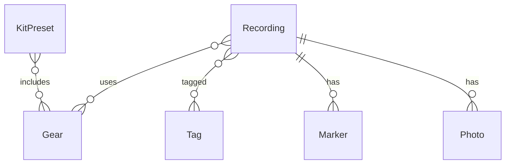

# FieldLog — Design

## TL;DR

FieldLog replaces an Apple Notes shortcut for logging field recording metadata. It is a single-user, local-first SwiftUI + SwiftData iOS app with one primary entity, `Recording`, a seeded `Gear` reference table with kit presets, and a `Tag` entity for both subject labels and project groupings. Location, timestamp, weather, and format auto-populate; filename is deferred and reconciled later against the WAV's BWF origination time. Sync is off but the model is written CloudKit-compatible from day one. Open: export format, and whether photos live in the app container or as Photos-library references.

## Context

The current Shortcut creates one Apple Note per recording with date, time, weather, filename, gear, format, gain, a Maps pin, one photo, and a description. It is slow to launch, offers only free-text entry, and editing after the fact means finding the note by hand. Two fields are wrong for the workflow: filename is usually unknown at capture time because the recording hasn't finished, and gain is meaningless on 32-bit float recorders (the Zoom F3 has no gain control).

The recorders are a Zoom F3 and H5studio, both 32-bit float. Mics and accessories are a fixed, small set that changes rarely.

## Goals and non-goals

Goals:

- Faster capture than the Shortcut, with structured entry (pickers, presets) instead of free text.
- Everything about a recording in one place, editable at any time.
- Capture what the Shortcut can't: markers during recording, multiple photos, mic technique.
- A model that survives turning on CloudKit later without migration.

Non-goals:

- Recording audio. The recorder does that.
- Managing or playing back audio files.
- Sync, sharing, or multi-user anything in v1.
- Editing BWF metadata in WAVs.

## Proposal

One screen to list recordings, one to create or edit a recording, one to manage gear. A new recording opens with timestamp, coordinates, reverse-geocoded place name, and weather already filled. Gear is a multi-select from the seeded list, with kit presets that fill it in one tap. Tags autocomplete from existing tags. While the entry is open, a marker button captures the offset from start time plus a short note. Photos attach in any number. Filename is an optional field the list view flags as missing.



## Key decisions

### Recording is self-contained; there is no session or outing entity

Many recordings happen one at a time (a one-off of Margot in the kitchen). Others cluster — several at Point Reyes on one afternoon — but they are distinct recordings, not takes, and each should stand alone. A parent entity would force structure at capture time for the common case to serve the less common one. Recordings at the same place share values, not a parent; if a grouped view is wanted later it can be derived from date and proximity without storing anything. The cost is nowhere to annotate the outing itself; a tag covers that if it ever matters.

### Tags cover both subjects and projects

"Birds" and "Margot's birth" are both many-to-many labels on recordings. The difference is only whether the group carries its own description, and nothing needs that today. `Tag` is an entity (name only) rather than a string array so that rename, autocomplete, and a later optional description are non-breaking. Groupings that span days and places — Margot's birth — are tags, not a separate collection concept.

### Gear is a reference table with kit presets

Gear rarely changes and is a small fixed set, so it is seeded once and selected from, not typed. Each `Gear` has a type (recorder, mic, windshield, mount, accessory). A `KitPreset` is a named set of gear — "full kit," "minimal 3.5mm" — that populates a recording's gear in one tap. Presets exist because that is how the kit is actually packed. Sample rate and bit depth default from the selected recorder.

### Filename is deferred, not required

The file doesn't have a name until the recording stops, so the field is optional and the list view highlights entries without one. Longer term the app stores start time precisely enough to match against BWF origination time when WAVs are imported on the Mac, at which point the field can be filled automatically.

### Gain is dropped

Both recorders are 32-bit float; level is set in post and the F3 has no gain control. An optional free-text note covers any future fixed-point recorder.

### CloudKit-compatible model with sync off

Sync is not needed until there is a second device, and CloudKit debugging would distract from schema work. But the constraints CloudKit imposes — every property optional or defaulted, relationships optional, no unique attributes — are cheap to honor now and expensive to retrofit. The model follows them from the first commit; enabling sync later is a capability checkbox and a `ModelConfiguration` argument.

## Data model

```swift
@Model final class Recording {
    var startedAt: Date = Date()
    var endedAt: Date?
    var latitude: Double?
    var longitude: Double?
    var placeName: String?          // reverse-geocoded, user-editable
    var weatherSummary: String?     // conditions text
    var temperatureC: Double?
    var windSpeedKph: Double?
    var windDirectionDeg: Double?
    var filename: String?           // deferred
    var sampleRateHz: Int?          // defaulted from recorder
    var bitDepth: String?           // "32-bit float", "24-bit"
    var micTechnique: String?       // "spaced pair 40cm", "ORTF", "geophon on pier"
    var captureDescription: String = ""   // written in the field
    var notes: String = ""                // written later
    var isCompromised: Bool = false       // noise / interruption
    var rating: Int?                      // post-review
    var gear: [Gear]? = []
    var tags: [Tag]? = []
    @Relationship(deleteRule: .cascade) var markers: [Marker]? = []
    @Relationship(deleteRule: .cascade) var photos: [Photo]? = []
}

@Model final class Gear {
    var name: String = ""
    var type: String = ""            // recorder | mic | windshield | mount | accessory
    var defaultSampleRateHz: Int?    // recorders only
    var defaultBitDepth: String?
    var recordings: [Recording]? = []
    var presets: [KitPreset]? = []
}

@Model final class KitPreset {
    var name: String = ""
    var gear: [Gear]? = []
}

@Model final class Tag {
    var name: String = ""
    var recordings: [Recording]? = []
}

@Model final class Marker {
    var offsetSeconds: Double = 0
    var note: String = ""
    var recording: Recording?
}

@Model final class Photo {
    var filename: String = ""        // relative path in app container
    var takenAt: Date?
    var recording: Recording?
}
```

Every property has a default or is optional, and every relationship is optional, per the CloudKit rule. `type` and `bitDepth` are strings rather than enums to keep migrations trivial; validate in the UI.

## Alternatives considered

**Session → Take hierarchy.** Tempting because weather, gear, location, and photos are per-outing and it avoids repeating them. Rejected because the common case is a single recording, gear presets and auto-population already remove the repetition, and the entity is painful to remove once the UI is built around it.

**Collection as a separate entity from Tag.** Would give project groupings a description and status. Rejected for v1 because nothing needs the description yet and `Tag` can grow one without migration.

**A "new recording from this one" action.** Copies context into a fresh entry for back-to-back recordings. Rejected: presets and auto-population cover it, and speed at capture isn't the constraint.

**Keeping the Shortcut and appending to a markdown file in Obsidian.** Zero code and the data lands where notes already live. Rejected because it fixes the destination but not the slow launch, free-text entry, or editing problem, and gives up markers.

## Open questions

- **Export format.** Markdown into Obsidian, JSON, or CSV — decide before real data goes in, since it shapes what's worth capturing.
- **Photo storage.** Copying into the app container is simple and survives camera-roll culling but duplicates storage. Referencing Photos by asset identifier avoids duplication but breaks on delete. Leaning toward copying.
- **WeatherKit field set.** Which fields are worth storing beyond conditions, temperature, and wind. Humidity and pressure are cheap; whether anyone looks at them is the question.
