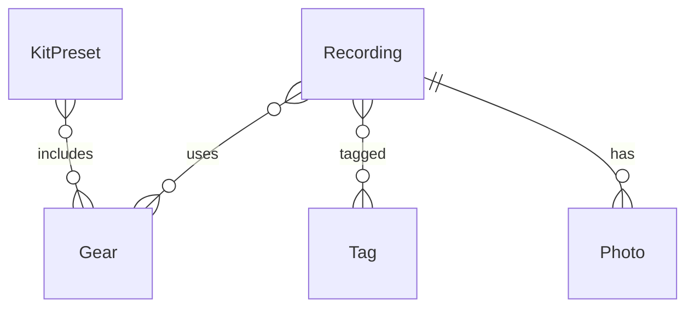

# FieldLog — Design

## TL;DR

FieldLog replaces an Apple Notes shortcut for logging field recording metadata. It is a single-user, local-first SwiftUI + SwiftData iOS app with one primary entity, `Recording`, a seeded `Gear` reference table with kit presets, and a `Tag` entity for both subject labels and project groupings. Location, timestamp, weather, and format auto-populate; filename is optional and typed once the file exists. Photos are downscaled copies stored with the log; the Photos library is not involved. Markers and an end time were built and then removed after real use. Sync is off but the model is written CloudKit-compatible from day one. Export is deferred until something needs the data. One question is open: what the start time should default to.

## Context

The current Shortcut creates one Apple Note per recording with date, time, weather, filename, gear, format, gain, a Maps pin, one photo, and a description. It is slow to launch, offers only free-text entry, and editing after the fact means finding the note by hand. Two fields are wrong for the workflow: filename is usually unknown at capture time because the recording hasn't finished, and gain is meaningless on 32-bit float recorders (the Zoom F3 has no gain control).

The recorders are a Zoom F3 and H5studio, both 32-bit float. Mics and accessories are a fixed, small set that changes rarely.

## Goals and non-goals

Goals:

- Faster capture than the Shortcut, with structured entry (pickers, presets) instead of free text.
- Everything about a recording in one place, editable at any time.
- Capture what the Shortcut can't: multiple photos, mic technique, structured gear.
- A model that survives turning on CloudKit later without migration.

Non-goals:

- Recording audio. The recorder does that.
- Managing or playing back audio files.
- Sync, sharing, or multi-user anything in v1.
- Editing BWF metadata in WAVs.

## Proposal

One screen to list recordings, one to create or edit a recording, one to manage gear. A new recording opens with timestamp, coordinates, reverse-geocoded place name, and weather already filled. Gear is a multi-select from the seeded list, with kit presets that fill it in one tap. Tags autocomplete from existing tags. Photos attach in any number. Filename is an optional field the list view flags as missing.



## Key decisions

### Recording is self-contained; there is no session or outing entity

Many recordings happen one at a time (a one-off of Margot in the kitchen). Others cluster — several at Point Reyes on one afternoon — but they are distinct recordings, not takes, and each should stand alone. A parent entity would force structure at capture time for the common case to serve the less common one. Recordings at the same place share values, not a parent; if a grouped view is wanted later it can be derived from date and proximity without storing anything. The cost is nowhere to annotate the outing itself; a tag covers that if it ever matters.

### Tags cover both subjects and projects

"Birds" and "Margot's birth" are both many-to-many labels on recordings. The difference is only whether the group carries its own description, and nothing needs that today. `Tag` is an entity (name only) rather than a string array so that rename, autocomplete, and a later optional description are non-breaking. Groupings that span days and places — Margot's birth — are tags, not a separate collection concept.

### Gear is a reference table with kit presets

Gear rarely changes and is a small fixed set, so it is seeded once and selected from, not typed. Each `Gear` has a type (recorder, mic, windshield, mount, accessory). A `KitPreset` is a named set of gear — "full kit," "minimal 3.5mm" — that populates a recording's gear in one tap. Presets exist because that is how the kit is actually packed. Sample rate and bit depth default from the selected recorder.

### Filename is deferred, not required

The file doesn't have a name until the recording stops, so the field is optional and the list view highlights entries without one. Typing the name afterwards is quick enough that nothing more is planned. A possible later addition: the recorder writes its start time into the WAV's BWF `bext` chunk, and `startedAt` is stored precisely enough to match against it, so the field could be filled automatically from imported WAVs. Decided September 2026 that this is not worth building unless typing the name becomes a chore.

### Gain is dropped

Both recorders are 32-bit float; level is set in post and the F3 has no gain control. An optional free-text note covers any future fixed-point recorder.

### Photos are stored copies, not Photos-library references

Decided September 2026, reversing the original plan. A `Photo` holds a JPEG downscaled to 2000 px on the long side (a few hundred KB) in SwiftData external storage, plus the capture date. Photos taken for a log belong to the log: they are captured with the system camera hosted in the app, or copied in from the library through the picker, and they travel with the recording — into device backups now, into CloudKit as assets later, and into exports without touching the library. Viewing needs no permission, and nothing turns into a placeholder if the library changes. Supplementary shots of the setup can still live in Photos, taken with the Camera app; the timestamp and location make them easy to find, but they are not part of the log.

The original reference design (store a `PHAsset.localIdentifier`, fetch on demand) was built first and dropped because Apple exposes less than assumed: there is no way to open Photos at a specific asset, thumbnails need library read permission, identifiers are per device so they would not survive sync, and a deleted original left a placeholder. Live Photos become stills in the app; that is acceptable.

### Markers and end time are dropped

Decided October 2026, after the first real recordings, reversing both the original plan and step 6's work. Markers assumed the app would be open while the recorder was rolling, and it is not: the form gets filled after the fact, so a marker button has nothing to time against. The recorders can drop marks themselves during a take, written into the file where an editor reads them at a sample position rather than at a wall-clock offset, which is strictly better than anything the app could record. `endedAt` went for the same reason plus one more: when a recording stopped is a fact about the audio file, and duration comes free out of the WAV header, so logging it by hand produced something already available.

Both were removed from the model rather than just hidden in the form. Deleting a property and an entity is a change SwiftData's automatic lightweight migration infers on its own, since the new model has nowhere to put the old data; what needs a hand-written plan is renames and type changes. Verified before shipping by opening a store written with the old schema against the new one: the `ZENDEDAT` column and the `ZMARKER` table are dropped, and recordings, gear, tags, and photos survive, including the many-to-many join tables that get renumbered when an entity leaves the schema.

If marks ever need to live in the app, they come back as a new entity, which is an additive change and therefore cheap. That asymmetry is the reason not to keep them around unused.

### CloudKit-compatible model with sync off

Sync is not needed until there is a second device, and CloudKit debugging would distract from schema work. But the constraints CloudKit imposes — every property optional or defaulted, relationships optional, no unique attributes — are cheap to honor now and expensive to retrofit. The model follows them from the first commit; enabling sync later is a capability checkbox and a `ModelConfiguration` argument.

## Data model

```swift
@Model final class Recording {
    var startedAt: Date = Date()
    var latitude: Double?
    var longitude: Double?
    var placeName: String?          // reverse-geocoded, user-editable
    var weatherSummary: String?     // conditions text
    var temperatureC: Double?
    var windSpeedKph: Double?
    var windDirectionDeg: Double?
    var humidity: Double?           // 0–1
    var pressureHPa: Double?
    var cloudCover: Double?         // 0–1
    var precipitationMmPerHour: Double?
    var filename: String?           // deferred
    var sampleRateHz: Int?          // defaulted from recorder
    var bitDepth: String?           // "32-bit float", "24-bit"
    var micTechnique: String?       // "spaced pair 40cm", "ORTF", "geophon on pier"
    var captureDescription: String = ""   // written in the field
    var notes: String = ""                // written later
    var isCompromised: Bool = false       // noise / interruption
    var rating: Int?                      // post-review
    var gear: [Gear]? = []
    var tags: [Tag]? = []
    @Relationship(deleteRule: .cascade) var photos: [Photo]? = []
}

@Model final class Gear {
    var name: String = ""
    var type: String = ""            // recorder | mic | windshield | mount | accessory
    var defaultSampleRateHz: Int?    // recorders only
    var defaultBitDepth: String?
    var recordings: [Recording]? = []
    var presets: [KitPreset]? = []
}

@Model final class KitPreset {
    var name: String = ""
    var gear: [Gear]? = []
}

@Model final class Tag {
    var name: String = ""
    var recordings: [Recording]? = []
}

@Model final class Photo {
    @Attribute(.externalStorage) var imageData: Data?  // JPEG, ≤ 2000 px long side
    var takenAt: Date?                                 // EXIF date, or capture time
    var recording: Recording?
}
```

Every property has a default or is optional, and every relationship is optional, per the CloudKit rule. `type` and `bitDepth` are strings rather than enums to keep migrations trivial; validate in the UI.

## Alternatives considered

**Session → Take hierarchy.** Tempting because weather, gear, location, and photos are per-outing and it avoids repeating them. Rejected because the common case is a single recording, gear presets and auto-population already remove the repetition, and the entity is painful to remove once the UI is built around it.

**Collection as a separate entity from Tag.** Would give project groupings a description and status. Rejected for v1 because nothing needs the description yet and `Tag` can grow one without migration.

**A "new recording from this one" action.** Copies context into a fresh entry for back-to-back recordings. Rejected: presets and auto-population cover it, and speed at capture isn't the constraint.

**Keeping the Shortcut and appending to a markdown file in Obsidian.** Zero code and the data lands where notes already live. Rejected because it fixes the destination but not the slow launch, free-text entry, or editing problem.

## Open questions

- ~~**Export format.**~~ Decided Sept 2026: deferred, no format chosen. The app replaces the notes setup rather than feeding it, so there is no destination to export to; the old notes are imported, not the other way round. Backup is covered by iCloud device backup of the app container (the store and its external photo storage) and by CloudKit sync once it is on. If a consumer appears later, its needs pick the format.
- ~~**WeatherKit field set.**~~ Decided Sept 2026: store conditions, temperature, wind speed and direction, humidity, pressure, cloud cover, and precipitation intensity. All come from the same WeatherKit call and are optional columns, so trimming later is the only migration risk.
- **What `startedAt` should default to.** Open, raised October 2026. It defaults to the moment the form opens, which is when the entry gets written, not when the recording began. Since entries are filled in after the fact, that means correcting it on every recording. Open rather than decided because each option costs something: living with it is a correction per entry; rounding or snapping to a nearby time hides the error instead of fixing it; prompting on create slows the one screen that exists to be fast; and reading the true time out of the WAV means building the BWF matching that was already judged not worth it. Worth deciding once more entries show how far off the default usually lands.
